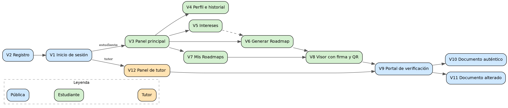

# Informe de cambios

## Alcance

Se retiró el frontend construido con React y Vite para dejar el backend Python y las vistas estáticas existentes. La guía identifica las tareas de integración y API con Román Pinto Leroy Raúl; actualicé el README con las rutas y variables de entorno que sí existen en el código actual.

## Cambios realizados

- Eliminados los componentes, estilos y cliente API de React (`frontend/src/`), junto con `package.json`, `package-lock.json`, configuración de Vite y ESLint, la página de entrada React y su README de plantilla.
- Conservadas las pantallas HTML, CSS y JavaScript estáticas de `frontend/`.
- Actualizado el README raíz: ejecución sin Node.js, servidor estático en puerto 3000, endpoints reales y variables de entorno.
- Cambiado el enlace de verificación predeterminado de los PDFs al puerto 3000 para coincidir con el servidor estático.
- Se dejó explícito en el README que algunas rutas descritas por la guía todavía no están implementadas en esta versión.

## Verificación

Se revisó que los archivos eliminados fueran exclusivos del shell React/Vite y que las páginas estáticas permanecieran. No ejecuté pruebas ni la API durante este cambio. El árbol Git aún requiere la autorización local para crear la rama y registrar el commit, porque `.git` está protegido como solo lectura.

## Imagen de referencia

El diagrama de navegación existente del proyecto:

